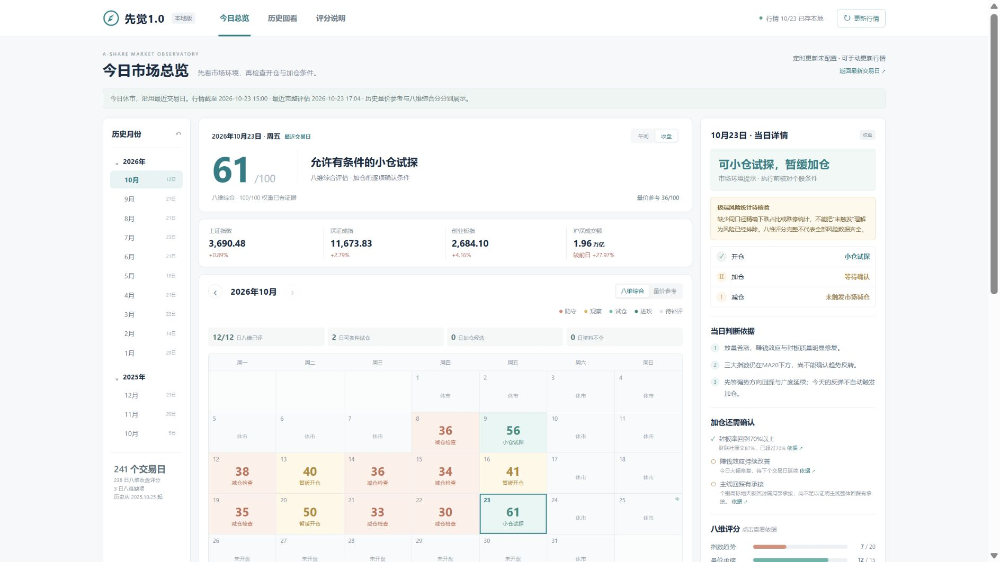

# 先觉1.0

A股市场环境观察与仓位条件清单，原项目名“仓位指南”。使用 Python 标准库提供本机网页，无需 npm 安装、第三方 Python 包、数据库或 API 密钥。项目版本为 1.0.0，GitHub 仓库名为 `xianjue-1.0`。

这是当前已经实现的市场总览、历史日历、八维评估和来源追溯版本；不包含讨论中的持仓工作台等概念图功能。只监听本机，不连接证券账户、不自动交易。



## 从 GitHub 下载并在 Codex 本地运行

1. 使用有权限的 GitHub 账号克隆本仓库，或下载 ZIP 后先解压。仓库为私有时，需要相应 GitHub 账号权限。
2. 在 Codex 中添加/打开解压后的项目文件夹，选择包含本 README、`server.py` 和 `AGENTS.md` 的目录。选择本地环境；云端执行的 `127.0.0.1` 不是你的电脑。
3. 本机需要 Python 3.10 或更高版本。Windows 启动器自动检查 PATH 中的 `python.exe` 或 `py.exe`；缺少时会给出提示，不会自动安装软件。
4. Windows 双击 **`启动先觉1.0.cmd`**。浏览器打开 **http://127.0.0.1:18789/**。原 `启动仓位指南.cmd` 保留兼容。

也可以让 Codex 在项目目录执行：

```powershell
powershell.exe -NoProfile -ExecutionPolicy Bypass -File .\start.ps1
```

若已有另一个项目占用默认端口，可指定独立端口：

```powershell
powershell.exe -NoProfile -ExecutionPolicy Bypass -File .\start.ps1 -Port 18790
```

启动器验证当前服务属于本目录，不会关闭其他程序，也不会把其他副本误报为本次启动成功。诊断日志在 `data/server.stderr.log`。`-NoBrowser` 可以只启动服务。

通用终端启动（Windows/macOS/Linux）：

```sh
python server.py --port 18789
```

部分系统的命令名为 `python3`。首次启动会从仓库内的行情与评估离线生成 `data/dashboard.json`，不要求首次联网成功。关闭这个终端会结束前台服务；Windows 双击启动方式在后台运行。

官方 Codex 项目与本地文件夹说明：[Projects and chats](https://learn.chatgpt.com/docs/projects)。迁移验证与边界见 [DEPLOYMENT.md](DEPLOYMENT.md)。

截至2026-10-25维护：近一年滚动窗口内为2025-10-27—2026-10-23，共241个交易日；238日显示完整八维分，2026-01-27、05-08、09-14因来源统计冲突暂缓综合判断。全部243份原始评估仍保存在本机，窗口外记录没有删除。过去缺失的午间记录保持空白。

此处为随 1.0 版本保存的历史数据快照，不保证下载当天已经更新。公开来源可能暂时不可访问；网页会保留旧数据并显示时点、缺项和失败原因。交易日历当前覆盖至 2026-12-31，后续需按交易所安排维护。

点击左侧月份查看月历、月内评分曲线和“本月逐日结论”，点击日期查看开仓、加仓、减仓检查及八个维度的来源。月历下方分别列出评分/时段记录缺口和加仓条件待核验日期。历史回评方法与验证说明见 `HISTORY.md`、`HISTORY_VERIFICATION.md`。

按已确认的第三张样图实现：月度交易日历、历史月份、当日详情、评分轨迹。仅运行在本机 127.0.0.1，不连接证券账户、不自动交易。

## 数据口径

- 量价参考：使用真实指数日线，固定规则复算，不是完整八维分，不单独许可加仓。
- 八维综合：趋势20、量价15、赚钱效应15、短线情绪15、主线15、政策10、外部5、事件5。只有八项证据齐全才显示总分。
- 来源的涨停/炸板家数与封板率存在超过1个百分点的矛盾时，短线情绪维度暂停计分，综合分留空。原始评估不改写，页面显示矛盾与待核验原因。
- 历史条件的“通过”未附逐项来源时，显示待核验；完整分数不等于加仓许可。缺少精确风险统计时，单独显示“极端风险统计待核验”。
- 缺失保留缺失，未来日期没有分数。历史量价分是当前规则的回算，不是当时已发布信号；不声称严格历史时点认证或收益概率。
- 午间快照和收盘记录分开保存；午间成交额不直接和全天均额比较，不冒充收盘。
- 页面明确区分数据日期、采集时间、评估完成时间和来源。

## 自动更新

新下载副本默认显示 **定时更新未配置**。原电脑的 Codex 定时任务不会随 GitHub 仓库转移；本机 `data/schedule.json` 被 Git 忽略。确需在新电脑自动研究更新时，再由用户在该电脑授权配置；约定见 [UPDATE.md](UPDATE.md)。直接下载并启动即可查看已保存记录，点击“更新行情”可以获取公开指数数据。

只有指数行情更新不会自动生成缺失的八维研究判断。打开网页也会检查遗漏的行情更新；休市日保留最近交易日，不制造新记录。失败保留上一次成功数据并记录原因。

主行情源暂不可用时，保留已下载的历史，使用腾讯报价并以新浪核对当日点位、时段和成交额。两处数据未核对一致则保留旧记录；备用流程不能补造漏掉的历史交易日。右上角“状态”可查看数据来源异常和备用更新结果。

休市日允许核验交易日历中最近已收盘日的报价；不会写入休市日期。已有该日历史值时，备用报价仅复核，不覆盖原精确记录。历史源日期缺失或三指数日期不一致不能记作完整更新成功。

`python update.py` 更新可直接获取的公开行情；`python update.py --offline` 仅按本地记录重算。

## 验证

```sh
python update.py --offline
python -m unittest discover -s tests -v
node --test tests/test_frontend.cjs
node --check public/app.js
```

Python 测试包含真实服务器的新目录启动、自定义端口、首次离线初始化、未配置定时任务、静态文件和访问限制检查。Node 20+ 仅用于前端回归测试，正常打开网页不需要 Node。

GitHub Actions 在 Windows 和 Ubuntu 上执行这些检查，Windows 另外检查 PowerShell 启动器。

## 文件与迁移边界

- 随仓库保留：网页源码、测试、行情、交易日历、全部 243 份原始评估、历史来源缓存及方法说明；包括原始评估明确引用的 11 份 raw/runs 来源文件。
- 首次运行生成：`data/dashboard.json`。
- 留在各自电脑：定时任务注册、更新状态、锁、进程号、运行日志、临时候选和本机测试截图。它们被 `.gitignore` 排除。
- 旧的 `HISTORY_VERIFICATION.md`、`VERIFICATION.md` 是注明日期的验收记录，不代表 1.0 当前全部数据已通过风险核验。当前缺项与冲突以页面和本 README 为准。
- 金融与新闻资料的权利属于各自来源，本仓库未附加开放源码授权，也未将来源资料声明为可自由再分发。

完整更新流程见 `UPDATE.md`。网站后台服务和更新进程分开运行；更新退出不会关闭网站。
